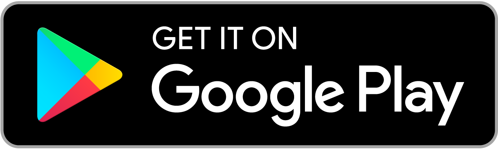
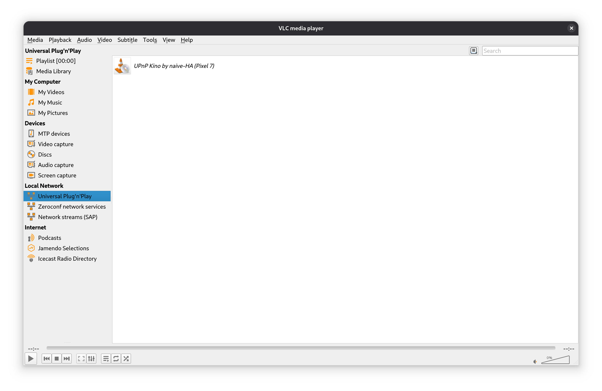
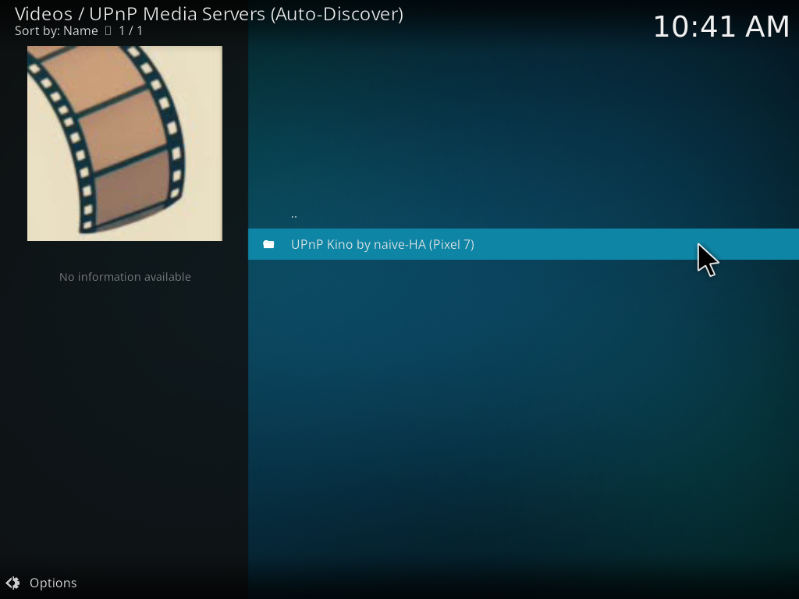
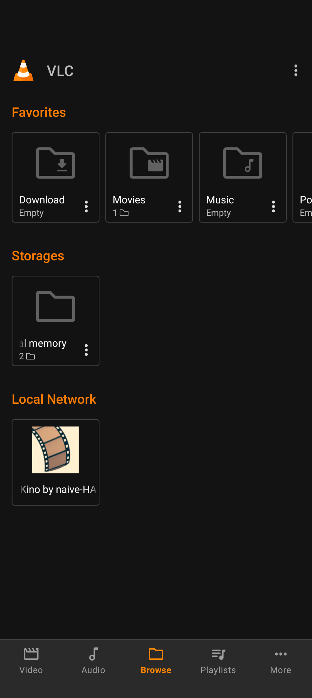
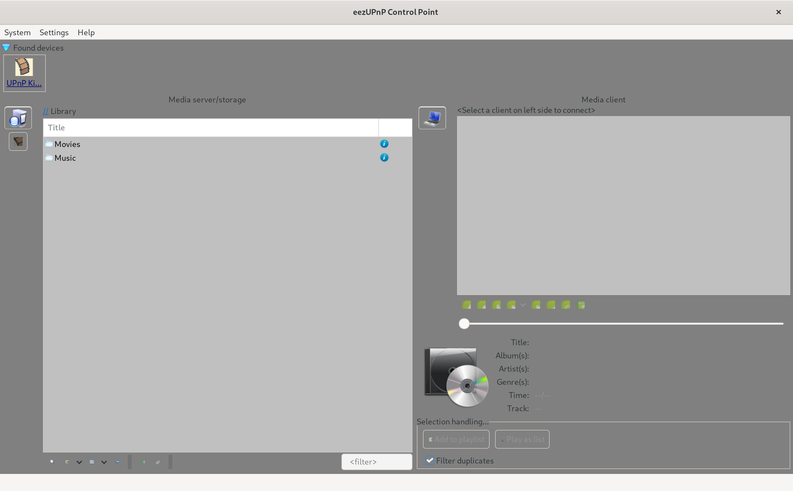

# UPnP Kino by naiveHA

**Your phone is the media server. Your TV is the cinema.**

You're a classic film collector. Over the years you've carefully ripped your Blu-ray collection of 1970s 
French comedies — every Louis de Funès film, from *Les Aventures de Rabbi Jacob* to *Le Gendarme de Saint-Tropez*
— gorgeous high-bitrate encodes, some pushing 40 or 50GB each.

Tonight, the family wants movie night on the big screen.

You *could* dig out a USB stick, copy the file over, and hope the TV's built-in player handles it. 
You *could* try that dusty DLNA app from 2017 — except it hasn't been updated since Android 8, and it 
chokes on anything over 2GB.

Or you open **UPnP Kino**, point it at your movie folder, and tap Start. A media server spins up right 
on your phone. UPnP Kino discovers every DLNA player on the WiFi — the living room VLC, the bedroom 
Kodi box, your partner's eezUPnP setup — and you pick the TV. Tap the file. Rabbi Jacob starts playing
(*Les Aventures de Rabbi Jacob*). Full quality, not a single frame re-encoded.

You lock your phone, walk to the kitchen, and start on the popcorn. Background streaming keeps the film going
— screen off, other apps open, it doesn't matter. The stream doesn't drop.

Last weekend you filmed your toddler's first steps into the ocean — shaky, sun-drenched, and absolutely perfect. 
The grandparents are visiting and everyone's gathered around the living room TV. *"Show us the video!"*

So you try. AirPlay? Wrong ecosystem. Miracast? The TV doesn't support it. Email it? It's a 4K clip, 1.2GB, 
so that's not happening. Everyone needs to crowd around a phone instead.

You fire up UPnP Kino, select the video folder, and tap Start. It finds the smart TV in seconds. 
One more tap and the whole family is watching the beach video on a 55-inch screen, 
laughing together instead of squinting at a 6-inch phone. No cables. No accounts. 
No uploading to any cloud. The video never leaves your home network.

**No accounts. No subscriptions. No cloud. No tracking.** Your media stays on your network, 
streamed from your pocket. This is UPnP Kino

## Features

**Wide Format Support**: Video: `mp4` `mkv` `mov` `webm` — Audio: `mp3` `m4a` `aac` `flac` `wav` `opus`

**Large File Support**: Handles files larger than 2GB — perfect for high-quality H.264/HEVC encodes 
that break legacy apps

**Background Streaming**: Keeps serving media even with the screen off or while you use other apps

**Quick Settings Tile**: Start/stop the server straight from your notification shade — no need to open the app

**Modern Backend**: Built on Eclipse Jetty 12 for reliable, high-throughput streaming

**Privacy First**: Zero tracking, zero analytics, zero ads. No data leaves your local network. [Read the full privacy policy](PRIVACY%20POLICY.md)

**Open Source**: Apache-2.0 licensed. Audit the code, fork it, contribute

## Screenshots

  
  &nbsp;&nbsp;
  

  
  &nbsp;&nbsp;
  

## Compatibility

- **Android**: 10 (API 29) or higher
- **Architecture**: arm64-v8a, armeabi-v7a, x86, x86_64

### Tested Players
**VLC** (Desktop & Mobile), **eezUPnP**, **Kodi**

## Permissions Explained

UPnP Kino requests only what it needs — nothing more.
**Local Network**: Discover and communicate with players on your WiFi

**Media Access**: Read the files you choose to share. On Android 14+, you can grant access to specific files only

**Notifications**: Show server status with a quick-stop control

**Foreground Service**: Keep the media server alive when you switch to other apps

See the [LICENSE](LICENSE) for terms (Apache-2.0).

## Support the Project

If UPnP Kino saved you from another evening of fiddling with cables and USB sticks

**BTC**: `1HwgShr1TniuBxNQwy2xAhpQaNuZhtw6sh`